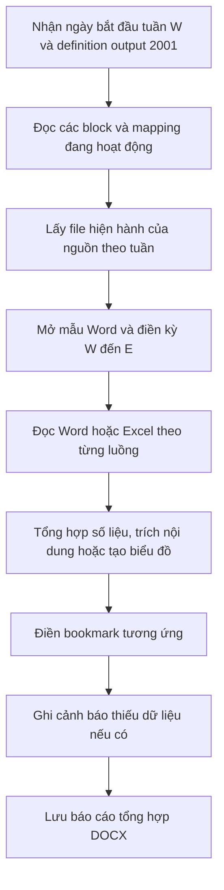

# Tài liệu các luồng xử lý dữ liệu báo cáo tuần

Ngày đối chiếu: **11/11/2026**.

Tài liệu trình bày theo 7 đầu mục báo cáo đầu vào, căn cứ vào [WeeklyWordOutputGenerator.java](../src/main/java/com/techasians/alertservice/service/impl/WeeklyWordOutputGenerator.java), các reader và script cấu hình trong repository. Kết quả của các luồng là nội dung trong **2001 – Báo cáo tuần VCX**, mẫu [weekly-vcx-word-template.docx](../src/main/resources/templates/weekly-vcx-word-template.docx). “Word + Excel” ở đầu mục lỗi phát sinh là hai loại **file đầu vào**; việc tạo phụ lục Excel 2002/2003 thuộc bộ sinh báo cáo khác.

ID nguồn, tên sheet và marker dưới đây mô tả cấu hình trong các script hiện có. Khi chạy, hệ thống sử dụng cấu hình đang hoạt động trong database; tài liệu này chưa xác minh cấu hình database hoặc số liệu của một lần sinh báo cáo thực tế.

**Thuật ngữ và kỳ báo cáo**

| Ký hiệu | Ý nghĩa |
|---|---|
| PAKH / PA | Phản ánh khách hàng / phản ánh |
| SC | Sự cố |
| W | Ngày bắt đầu tuần được truyền vào tác vụ; generator không tự chuyển về thứ Hai |
| E | Ngày kết thúc tuần, bằng W + 6 ngày |
| Tuần trước | Từ W − 7 ngày đến W − 1 ngày |
| Y | Năm của E; dùng thay `{yyyy}` trong tên sheet |
| C / B / D | Giá trị tuần hiện tại / tuần trước / chênh lệch C − B |
| Bookmark | Vùng được đánh dấu trong mẫu Word để điền nội dung |

**Luồng xử lý chung**

1. `WordGenerationSnapshotService.load()` kiểm tra definition đầu ra, lấy các block và mapping `status=1` theo thứ tự cấu hình.
2. Với từng nguồn, lấy `currentFileId` của instance đúng tuần có trạng thái `COMPLETED`, kiểm tra file thuộc instance đó. Nguồn chưa hoàn thành hoặc chưa có file được đưa vào snapshot dưới dạng thiếu file.
3. `WordSourceDocuments` tải file theo thông tin lưu trữ; mở Word bằng Aspose, Excel bằng Apache POI. Một file dùng cho nhiều block được tải/mở một lần trong tác vụ.
4. `generate()` mở template, điền kỳ `dd/MM/yyyy - dd/MM/yyyy` vào ba bookmark `BM_REPORT_PERIOD_TITLE`, `BM_REPORT_PERIOD_INTRO`, `BM_REPORT_PERIOD_CLOSING`, rồi chạy handler của từng block. Nếu bookmark kỳ chứa token `[DD/MM-DD/MM/YYYY]`, chỉ thay token và giữ câu xung quanh.
5. Dữ liệu được ghi bằng cách thay văn bản, chèn đoạn/bảng/ảnh Word hoặc chèn ảnh biểu đồ. Các luồng sao chép Word và SME áp dụng cỡ chữ nội dung 14 pt.
6. Lỗi thiếu dữ liệu đã được từng handler nhận diện sẽ tạo câu thay thế và cảnh báo. Cảnh báo được đưa xuống cuối tài liệu sau câu `Lưu ý: Báo cáo còn thiếu dữ liệu.` Sai cấu hình, thiếu bookmark bắt buộc, lỗi mở file, render hoặc lưu file có thể làm cả tác vụ thất bại với `Không thể tạo báo cáo Word`.
7. Generator lưu file DOCX tạm và trả về đường dẫn. `WordSourceDocuments` đóng workbook, dọn các file nguồn tạm khi kết thúc.

Các mapping biểu đồ hiện dùng `CHART_ACCUMULATED`: đọc dữ liệu 8 tuần trong **file lũy kế được nộp cho tuần W**, gồm cả sheet năm trước khi cần. Chúng không lấy 8 file upload của 8 tuần. Những nguồn còn lại trong tài liệu cũng lấy file được nộp cho tuần W; số liệu so sánh tuần trước nằm trong file nguồn đó.

## 1. Xử lý dữ liệu Báo cáo Lỗi phát sinh tuần (Word + Excel)

### 1.1. Mục đích và đầu vào

Tổng hợp sự cố hệ thống, sự cố trạm, đứt/cháy cáp; bổ sung sự cố nổi bật và biểu đồ xu thế 8 tuần.

| Nguồn | Loại | Dữ liệu sử dụng |
|---|---|---|
| 1101 – Word lỗi phát sinh tuần | Word, role TEXT | Section 8102: phần vấn đề/sự cố nổi bật |
| 1102 – Excel lỗi phát sinh tuần | Excel, role DATA | Sheet `TH`: ba bảng so sánh hệ thống, trạm và cáp |
| 1102 – Excel lỗi phát sinh tuần | Excel, role CHART_ACCUMULATED | `Lũy kế lỗi phát sinh năm {yyyy}`, `LPS năm {yyyy-1}`: chi tiết sự cố hệ thống |
| 1102 – Excel lỗi phát sinh tuần | Excel, dùng cho biểu đồ và top tỉnh | `Lũy kế trạm năm {yyyy}`, `Tổng trạm {yyyy-1}`: chi tiết sự cố trạm/cáp |

### 1.2. Trình tự xử lý

**Bước 1 – Đọc số liệu so sánh từ sheet TH.**

`WordSystemIncidentReader` tìm bảng theo nhãn và cột theo kỳ báo cáo hoặc nhãn `Tuần này`, `Tuần trước`; xác định thêm cột chênh lệch và tỷ lệ tăng/giảm. Các dòng dữ liệu cần nằm liên tục ngay sau header, không lấy số từ bảng bên dưới để bù dòng thiếu.

| Bảng | Dòng dữ liệu cần đọc | Nội dung tổng hợp |
|---|---|---|
| `Tổng lỗi phát sinh` | `Số lượng`, `PA` | SC và PA hệ thống tuần này; biến động so với tuần trước |
| `So sánh lỗi trạm` | `Số lượng`, `PA`, `TB ảnh hưởng` | SC trạm, PA, số thuê bao ảnh hưởng và biến động |
| `So sánh Sự cố đứt cáp, cháy cáp trục, cáp nhánh` | `Số lượng`, `PA`, `TB ảnh hưởng` | SC cáp, PA, số thuê bao ảnh hưởng và biến động |

Các số lượng B và C phải là số nguyên không âm. Với SC hệ thống, code tính `D = C − B` để diễn giải tăng/giảm theo số SC, không cần đọc giá trị chênh lệch/tỷ lệ của dòng SC. Với PA hệ thống và cả ba chỉ số trạm/cáp, code tính D rồi kiểm tra ô chênh lệch Excel phải bằng D.

Tỷ lệ tăng/giảm đọc sẵn từ Excel, làm tròn đến số nguyên khi hiển thị; code không tự tính lại `D/B × 100`. Nếu tỷ lệ khác 0 thì phải cùng chiều D. D = 0 được diễn giải là không biến động và không cần đọc ô tỷ lệ. Riêng trạm/cáp, B = 0 và C > 0 được diễn giải là tăng và tuần trước không phát sinh, không cần tỷ lệ. PA hệ thống không có ngoại lệ này.

**Bước 2 – Trích nội dung sự cố nổi bật từ Word.**

`copySections()` dùng section 8102, chế độ `TEXT_RANGE`, lấy các node nằm sau paragraph chứa `Vấn đề/Sự cố nổi bật:` và trước paragraph chứa `SỰ CỐ TRẠM CĐBR`. Theo cấu hình mặc định, cả hai paragraph marker đều bị loại.

Hệ thống sao chép các paragraph, bảng, ảnh trong khoảng; giữ font nguồn, căn chỉnh vị trí theo vùng đích và đưa cỡ chữ về 14 pt. Số liệu trong phần sao chép giữ như nguồn. Marker được tìm trong paragraph cấp body theo phép chứa chuỗi sau chuẩn hóa, không tìm trong text tổng hợp của bảng; marker trùng hoặc thiếu làm phần trích không hợp lệ.

**Bước 3 – Tổng hợp và vẽ ba biểu đồ xu thế.**

`WordIncidentChartReader` tạo 8 nhóm tuần từ **W − 7 tuần đến E**, tuần cũ nhất đứng trước. Mỗi dòng hợp lệ được tính là một SC; không khử trùng theo mã SC.

| Biểu đồ | Điều kiện chọn dòng | Chỉ số tổng hợp mỗi tuần |
|---|---|---|
| Hệ thống | `Chủ dịch vụ = VTT`, ngày hợp lệ trong cửa sổ | Số SC; tổng `Số lượng phản ảnh` |
| Trạm | Ngày hợp lệ trong cửa sổ, không lọc chủ dịch vụ/nguyên nhân | Số SC; tổng `Tổng PA`; tổng `Tổng ảnh hưởng` |
| Đứt/cháy cáp | Như trạm, thêm `Nguyên nhân cấp 1` chuẩn hóa bằng `đứt cáp` hoặc `cháy cáp` | Số SC; tổng `Tổng PA`; tổng `Tổng ảnh hưởng` |

Dữ liệu ngày thông thường ghép từ `Năm`, `Tháng`, `Ngày`. Riêng sheet hệ thống năm trước đọc tháng và năm từ cột `Tháng` dạng `Tháng n.yyyy`, rồi ghép với cột `Ngày`. Chỉ nhận dòng thuộc đúng năm của sheet đang đọc. Nếu cửa sổ 8 tuần đi qua năm trước thì đọc thêm sheet Y − 1 trong cùng workbook.

Các chỉ số PA/ảnh hưởng là tổng theo tuần, không chia 7. `WordTrendChartRenderer` tạo ảnh mới từ số liệu đã tổng hợp và chèn vào Word. Biểu đồ hệ thống thể hiện PA bằng cột, SC bằng đường; biểu đồ trạm/cáp thể hiện SC và PA bằng cột, tổng ảnh hưởng bằng đường. Không lấy ảnh biểu đồ có sẵn trong Excel.

**Bước 4 – Xác định top tỉnh có sự cố cáp.**

Từ sheet lũy kế trạm, lọc ngày trong **W–E** và nguyên nhân đứt/cháy cáp. Chuẩn hóa mã tỉnh bằng cách bỏ khoảng trắng thừa, chuyển chữ hoa; đếm số dòng SC theo tỉnh, sắp giảm theo số SC và tăng theo mã tỉnh khi bằng nhau, lấy tối đa 3 tỉnh. Ví dụ định dạng: `HCM – 14SC; DNI – 11SC; HNI – 10SC`.

Top tỉnh chỉ đọc thêm sheet năm trước khi chính tuần W–E vắt năm. Điều kiện này khác biểu đồ, vốn xét cả cửa sổ 8 tuần. Kết quả top tỉnh và biểu đồ không được tự ép khớp số trong TH.

### 1.3. Kết quả đầu ra

| Block | Bookmark đích | Kết quả |
|---|---|---|
| SYSTEM_INCIDENT | `BM_SYSTEM_INCIDENT` | Số SC, PA và diễn giải biến động hệ thống |
| INCIDENT | `BM_INCIDENT` | Nội dung sự cố nổi bật trích từ Word |
| STATION_OVERVIEW | `BM_STATION_OVERVIEW` | Số SC trạm, PA, thuê bao ảnh hưởng và so sánh |
| STATION_INCIDENT | `BM_STATION_INCIDENT` | Số liệu cáp và top tỉnh; các chỉ số con dùng tiền tố `BM_CABLE_` |
| SYSTEM_INCIDENT_CHART | `BM_SYSTEM_INCIDENT_CHART` | Ảnh biểu đồ hệ thống 8 tuần |
| STATION_INCIDENT_CHART | `BM_STATION_INCIDENT_CHART` | Ảnh biểu đồ trạm 8 tuần |
| CABLE_INCIDENT_CHART | `BM_CABLE_INCIDENT_CHART` | Ảnh biểu đồ đứt/cháy cáp 8 tuần |

### 1.4. Xử lý thiếu hoặc sai dữ liệu

- Thiếu file Word/marker hoặc phần trích rỗng: phần sự cố nổi bật thành `Chưa có dữ liệu`, thêm cảnh báo.
- TH thiếu bảng/header/số hợp lệ hoặc chênh lệch không khớp: thay block số liệu tương ứng bằng `Chưa có dữ liệu`; các block khác vẫn có thể xử lý.
- Biểu đồ thiếu sheet/header năm Y: ghi `Chưa đủ dữ liệu để tạo biểu đồ`. Thiếu nguồn/header năm Y − 1: vẫn vẽ từ dữ liệu năm Y, cảnh báo phần năm trước chưa đầy đủ; các nhóm chưa có dữ liệu giữ giá trị khởi tạo 0.
- Ngày chi tiết không hợp lệ: bỏ dòng và cảnh báo. Ô PA/ảnh hưởng không hợp lệ: không cộng chỉ số đó, cảnh báo; dòng vẫn có thể được tính vào số SC.
- Top tỉnh thiếu nguồn/header cần thiết: ghi `Chưa có dữ liệu`. Không có tỉnh hợp lệ trong khi TH ghi 0 SC: ghi `Không phát sinh sự cố`; TH có SC thì ghi thiếu dữ liệu và cảnh báo. Không trả top tỉnh một phần khi thiếu sheet năm trước của tuần vắt năm.

Căn cứ: [WordSystemIncidentReader.java](../src/main/java/com/techasians/alertservice/service/impl/WordSystemIncidentReader.java), [WordIncidentChartReader.java](../src/main/java/com/techasians/alertservice/service/impl/WordIncidentChartReader.java), [WordSectionExtractor.java](../src/main/java/com/techasians/alertservice/service/impl/WordSectionExtractor.java), [cấu hình nguồn Word](report-phase5-word-config.sql), [cấu hình cáp](report-phase5-cable-incident-excel.sql).

## 2. Xử lý dữ liệu Báo cáo PAKH dịch vụ Di động tuần

### 2.1. Mục đích và đầu vào

Tạo nhận xét về số PA di động trung bình/ngày, biến động so với tuần trước và nhóm PA điển hình cùng chiều biến động tổng.

Nguồn sử dụng là **Excel/XLSM 1104**, role DATA, sheet **`PL02-So lieu TN&XL`**. Mapping hiện tại không lấy nội dung Word 1103 để điền block MOBILE.

### 2.2. Trình tự xử lý

1. Tìm duy nhất header `TB tuần (dd/MM – dd/MM)` đúng W–E; tìm các cột `Tăng giảm`, `Tỷ lệ`, `Dịch vụ`, `STT`. Dòng ngay dưới header phải là `Phản ánh báo hỏng dịch vụ`.
2. Đọc trực tiếp ba số tại dòng tổng: A = TB tuần, D = Tăng giảm, R = Tỷ lệ. A phải không âm; D và R phải cùng dấu, kể cả trường hợp 0. Code không cộng các nhóm để tính tổng, không chia A cho 7 và không tính lại D hoặc R từ hai tuần.
3. Nếu D ≠ 0, duyệt các nhóm ngay sau dòng tổng với STT liên tiếp 1, 2, 3…; gặp sai thứ tự hoặc tên rỗng thì dừng. Chỉ xét nhóm có Tăng giảm cùng dấu D tổng, chọn nhóm có trị tuyệt đối Tỷ lệ lớn nhất; bằng nhau giữ nhóm xuất hiện trước.
4. Định dạng số và điền câu nhận xét. Nếu tên nhóm chưa bắt đầu bằng `Lỗi ` thì thêm tiền tố này.

### 2.3. Kết quả đầu ra

| Bookmark trong `BM_MOBILE` | Cách điền |
|---|---|
| `BM_MOBILE_AVERAGE` | A làm tròn số nguyên, đơn vị PA/ngày |
| `BM_MOBILE_CHANGE` | Chiều biến động và trị tuyệt đối R, tối đa 1 số thập phân; D = 0 thì `không có biến động` |
| `BM_MOBILE_CHANGE_DETAILS` | Chênh lệch D làm tròn số nguyên, có dấu +/−, đơn vị PA/ngày; D = 0 thì rỗng |
| `BM_MOBILE_DIRECTION` | `tăng` hoặc `giảm` theo tổng, sử dụng khi có nhóm điển hình |
| `BM_MOBILE_SERVICE` | Tên nhóm được chọn |
| `BM_MOBILE_SERVICE_CHANGE` | Biến động nhóm, tối đa 1 số thập phân; nhóm tăng có R > 100% dùng R/100 lần |

Ví dụ minh họa quy tắc: R nhóm = 680% được diễn giải `tăng 6,8 lần` theo code hiện tại. Mẫu câu: `Tiếp nhận 1.722PA/ngày, tăng 13,4% (+204PA/ngày) so với tuần trước. PA tăng điển hình là Lỗi Kết nối tăng 6,8 lần.` Các số trong ví dụ không phải kết quả của một tuần được xác minh trong tài liệu này.

### 2.4. Xử lý thiếu hoặc sai dữ liệu

- Thiếu file, sheet, header đúng kỳ hoặc bộ số tổng hợp lệ: `BM_MOBILE` thành `Chưa có dữ liệu`, kèm cảnh báo.
- Nhóm có số liệu sai: bỏ qua và cảnh báo, vẫn có thể chọn nhóm khác.
- Tổng không biến động: thay câu điển hình bằng `Không có PA biến động điển hình.`
- Tổng biến động nhưng không có nhóm hợp lệ cùng chiều: thay câu điển hình bằng `Chưa đủ dữ liệu để xác định PA điển hình.`

Ô công thức dùng kết quả đã lưu trong Excel, không tính lại. Ô số có định dạng phần trăm được quy đổi từ tỷ phần sang phần trăm trước khi diễn giải.

Căn cứ: [WordMobileFeedbackReader.java](../src/main/java/com/techasians/alertservice/service/impl/WordMobileFeedbackReader.java), [cấu hình MOBILE](report-phase5-mobile-feedback-excel.sql).

## 3. Xử lý dữ liệu Báo cáo PAKH dịch vụ Chất lượng mạng tuần

### 3.1. Mục đích và đầu vào

Tổng hợp tỷ lệ PA chất lượng mạng, chỉ tiêu thoại/data và danh sách tỉnh cảnh báo. Nguồn là **Excel 1107**, role DATA, sheet **`Tỷ lệ PA tuần`**, xử lý bởi `WordNetworkQualityReader`.

Header kỳ có dạng `Tuần từ dd.MM đến dd.MM`, có thể kèm năm; reader nhận cả dấu `.`, `,`, `/` giữa ngày và tháng. Mỗi nhóm kỳ có các cột `PA`, `Thuê bao`, `KQ`.

### 3.2. Trình tự xử lý

1. **Tổng quan:** tìm dòng `Tỷ lệ chung`, nhóm tuần hiện tại và tuần trước cùng hàng header. Đọc PA và Thuê bao hiện tại, KQ hai tuần. PA/Thuê bao phải nguyên không âm, Thuê bao hiện tại > 0. Tính PA/ngày = PA tuần hiện tại / 7, làm tròn số nguyên; so KQ hai tuần để xác định tăng/giảm/không đổi.
2. **Thoại:** tìm bảng `Chỉ tiêu thoại`, nhóm kỳ W–E, các cột `KPIs`, `Đánh giá`, `Nguồn tiếp nhận`; lấy dòng tổng, không dùng dòng tỉnh thay thế. Đọc KQ, KPI và đánh giá của dòng tổng; kiểm tra PA/Thuê bao, yêu cầu Thuê bao > 0.
3. **Data:** thực hiện tương tự với bảng `Chỉ tiêu Data`.
4. **Cảnh báo tỉnh:** đọc hai bảng `TOP 5 Tỉnh Thoại tăng cao nhất Tuần` và `TOP 5 Tỉnh Data tăng cao nhất Tuần`, tìm cột `Tỉnh`, `Tuần hiện tại`; đọc tối đa 5 dòng ngay sau header, dừng khi tên tỉnh trống. Bỏ tiền tố `Tỉnh`/`Thành phố`, ghép từng mục thành `Tên: xPA`.
5. Điền riêng tổng quan, thoại và data vào các vùng tương ứng; một phần thiếu dữ liệu không buộc loại các phần còn lại.

### 3.3. Kết quả đầu ra

| Vùng trong `BM_CLM` | Nội dung |
|---|---|
| `BM_CLM_OVERVIEW` | PA/ngày, KQ tuần hiện tại, KQ tuần trước, chiều biến động |
| `BM_CLM_VOICE` | KQ, KPI, đánh giá thoại, số tỉnh và danh sách cảnh báo thoại |
| `BM_CLM_DATA` | KQ, KPI, đánh giá data, số tỉnh và danh sách cảnh báo data |

KQ/KPI hiển thị tối đa 2 chữ số thập phân. **KQ và Đánh giá được đọc sẵn từ Excel**: code không tính lại tỷ lệ PA trên một triệu thuê bao và không tự so KQ với KPI. Đánh giá chỉ nhận `Đạt` hoặc `Không đạt`, cho phép hậu tố ` KPI`.

Danh sách tỉnh giữ thứ tự trong bảng top nguồn, không tự xếp hạng, lọc theo KPI hoặc tính mức tăng. Số tỉnh cảnh báo là số dòng hợp lệ đọc được, không phải số tỉnh không đạt trên toàn quốc. Vì vậy nội dung bảng top cần được đơn vị lập báo cáo chuẩn bị đúng nghiệp vụ.

### 3.4. Xử lý thiếu hoặc sai dữ liệu

- Thiếu file/sheet: toàn bộ `BM_CLM` thành `Chưa có dữ liệu`.
- Tổng quan, thoại hoặc data không hợp lệ: chỉ vùng tương ứng thành `Chưa có dữ liệu`, kèm cảnh báo.
- Một dòng tỉnh lỗi số liệu: bỏ dòng và cảnh báo. Có ít hơn 5 dòng hợp lệ: vẫn xuất danh sách đọc được, đồng thời cảnh báo.
- Không đọc được bảng tỉnh hoặc không có tỉnh hợp lệ: ghi `Chưa đủ dữ liệu cảnh báo tỉnh.`, vẫn giữ KQ/KPI nếu hợp lệ.

Ô công thức dùng kết quả đã lưu, không tính lại.

Căn cứ: [WordNetworkQualityReader.java](../src/main/java/com/techasians/alertservice/service/impl/WordNetworkQualityReader.java), [cấu hình CLM](report-phase5-network-quality-excel.sql).

## 4. Xử lý dữ liệu Báo cáo PAKH dịch vụ SME tuần

### 4.1. Mục đích và đầu vào

Lấy phần diễn giải tình hình tiếp nhận và xử lý PAKH SME từ Word nguồn, gộp thành một đoạn trong báo cáo tổng hợp.

Nguồn là **Word 1108**, role TEXT, section **8110 – WORD_SME**, chế độ `TEXT_RANGE`. Cấu hình mặc định:

| Thuộc tính | Giá trị |
|---|---|
| Marker bắt đầu | `Tình hình tiếp nhận và xử lý PAKH:` |
| Marker kết thúc | `Xu thế PAKH theo tuần:` |
| Lấy paragraph marker | Không lấy cả hai: `include_start=0`, `include_end=0` |
| Bookmark đích | `BM_SME` |

### 4.2. Trình tự xử lý

1. Kiểm tra đúng một nguồn Word, section đang hoạt động thuộc nguồn, role TEXT và không cấu hình sheet Excel. Section phải có đủ marker và giá trị include_start/include_end hợp lệ.
2. Tìm duy nhất paragraph cấp body chứa marker bắt đầu, sau chuẩn hóa chữ và khoảng trắng.
3. Đọc lần lượt nội dung sau marker bắt đầu; dừng trước **ảnh đầu tiên hoặc marker kết thúc**, tùy điều kiện nào đến trước. Nếu chữ và ảnh cùng paragraph, giữ phần chữ đứng trước ảnh.
4. Bỏ dấu bullet/gạch đầu dòng dạng text ở đầu đoạn, chuẩn hóa khoảng trắng; ghép các đoạn thành một paragraph. Nếu cấu hình include_* khác mặc định, xử lý paragraph marker theo cờ đó.
5. Chèn các run chữ vào `BM_SME`, giữ nhấn mạnh bold/italic/underline/màu, dùng font theo vùng đích và cỡ 14 pt.

### 4.3. Kết quả đầu ra

Một đoạn diễn giải SME tại `BM_SME`. Số PA, tỷ lệ và nhận xét giữ theo Word nguồn; code không đọc Excel 1109 hoặc một nguồn KPI khác để tính lại các số này. Ảnh dùng làm ranh giới kết thúc, không được chèn vào phần SME.

### 4.4. Xử lý thiếu hoặc sai dữ liệu

Thiếu file, marker bắt đầu thiếu/trùng, gặp bảng trước ảnh/marker kết thúc, không có cả ảnh lẫn marker kết thúc, hoặc nội dung sau trích rỗng: điền `Chưa có dữ liệu` và ghi cảnh báo.

Có ảnh kết thúc hợp lệ thì reader có thể thành công dù chưa gặp marker kết thúc. Script SME giữ marker/include_* đã có nếu section 8110 tồn tại; khi vận hành cần đối chiếu cấu hình section thực tế với mặc định trên.

Căn cứ: [WordSmeFeedbackReader.java](../src/main/java/com/techasians/alertservice/service/impl/WordSmeFeedbackReader.java), [cấu hình SME](report-phase5-sme-feedback-word.sql).

## 5. Xử lý dữ liệu Báo cáo PAKH dịch vụ Cố định tuần

### 5.1. Mục đích và đầu vào

Tổng hợp tiếp nhận PAKH cố định, sự cố kỹ thuật, TLPA/10K, đánh giá KPI FTTH GPON/THS và tình hình TV360. Trong Word tổng hợp, đầu mục này được xử lý thành **hai block FIXED và TV360**.

| Nguồn theo mapping | Sheet | Vai trò |
|---|---|---|
| Excel 1106 | `N.Xet tuan`, sort_order=1 | Số liệu cố định tuần hiện tại và tuần trước |
| Excel 1106 | `TH`, sort_order=2 | Ngưỡng KPI FTTH GPON/Truyền hình số |
| Excel 1112 | `NDPA`, sort_order=1 | Tổng PA TV360, nhóm phản ánh và tỷ trọng |
| Excel 1112 | `NNLOI`, sort_order=2 | Tỷ trọng nguyên nhân lỗi TV360 |

**Điểm cần đối soát cấu hình:** FIXED hiện trỏ tới **1106**, dù tên definition 1106 trong master là “Báo Cáo Excel 1 Dịch Vụ Chất Lượng Mạng Tuần”, còn nhóm cố định liên kết Excel 1111. Tài liệu ghi theo mapping FIXED trong script; khi vận hành cần kiểm tra workbook thực tế được nộp dưới 1106. Handler hiện không trích phần Word 1110 để bổ sung tiến độ xử lý.

### 5.2. Trình tự xử lý dữ liệu cố định

1. Trong `N.Xet tuan`, tìm nhóm `Cùng kỳ tuần trước`; xác định duy nhất cột W–E trước nhóm này và cột tuần trước đúng kỳ bên trong nhóm. Chỉ tìm nhãn chỉ tiêu trong phạm vi bảng đã chọn.
2. Đọc các dòng chỉ tiêu và tính số liệu theo bảng dưới. Nhãn `HTDV + sự cố chuyển BO`, `HTDV + sự cố chuyển KT`, `SỰ CỐ chuyển KT` là các dòng riêng biệt.
3. Đọc tỷ lệ GPON/THS ở phần dịch vụ dưới dòng `TLPA/10K`.
4. Trong sheet `TH`, tìm bảng có cột `Chỉ tiêu`, `KPI`, dòng `FTTH GPON` và `Truyền hình số`; đọc ngưỡng tối đa của từng dịch vụ. Không cố định ngưỡng bằng hằng số Java.
5. So tỷ lệ dịch vụ với ngưỡng: **Đạt nếu rate ≤ KPI**, ngược lại Không đạt. Điền từng phần tiếp nhận, kỹ thuật, TLPA và dịch vụ độc lập.

| Chỉ số đầu ra | Dữ liệu và công thức |
|---|---|
| PA tiếp nhận/ngày | `(HTDV + sự cố chuyển BO + HTDV + sự cố chuyển KT) / 7`, cộng giá trị của đúng hai dòng, làm tròn số nguyên |
| SC kỹ thuật/ngày | Giá trị dòng `SỰ CỐ chuyển KT` tuần hiện tại / 7, làm tròn số nguyên |
| Biến động SC kỹ thuật | `(S_C − S_B) / S_B × 100`, tính từ tổng tuần chưa làm tròn, hiển thị chiều và trị tuyệt đối %, làm tròn số nguyên |
| TLPA/10K hiện tại | Đọc trực tiếp dòng `TLPA/10K`, tối đa 2 số thập phân |
| Biến động TLPA/10K | Hiệu `R_C − R_B`, hiển thị chiều và trị tuyệt đối, tối đa 2 số thập phân, đơn vị PA |
| Tỷ lệ GPON/THS | Đọc dòng `FTTH GPON`, `THS`/`Truyền hình số` thuộc phần TLPA/10K, tối đa 2 số thập phân |
| KPI GPON/THS | Ngưỡng từ TH và kết luận do code so sánh |

Không cộng thêm dòng `SỰ CỐ chuyển KT` vào tổng tiếp nhận lần thứ hai. TLPA/10K đọc sẵn, không tính lại từ số PA và thuê bao. Nếu chỉ số so sánh bằng nhau thì ghi `không đổi`; S_B = 0 và S_C > 0 thì thiếu phần so sánh phần trăm, còn hai tuần cùng bằng 0 vẫn ghi không đổi.

### 5.3. Trình tự xử lý TV360

1. Trong `NDPA`, tìm duy nhất dòng `DỊCH VỤ TV360`, nhóm header W–E và các cột con `TB ngày`, `Tỷ trọng ngày`; xác định cột `STT`, `Nội dung phản ánh`.
2. Đọc TB ngày ở dòng tổng cho tuần hiện tại A và tuần trước B. Tổng hiển thị bằng A làm tròn số nguyên; không chia 7. Nếu A = B thì ghi không đổi, còn B > 0 thì tính `(A − B)/B × 100`.
3. Đọc các dòng nhóm tổng hợp có STT số nguyên dương tăng dần; dừng trước STT sai hoặc bắt đầu lại để không lấy bảng thiết bị chi tiết phía dưới. Chỉ chọn nhóm có tỷ trọng dương, sắp giảm theo tỷ trọng, bằng nhau giữ thứ tự nguồn; lấy tối đa 2 nhóm.
4. Trong `NNLOI`, tìm bảng TV360 cùng kỳ; đọc tỷ trọng của đúng hai nhóm `Hỗ trợ khách hàng` và `Lỗi phía khách hàng`. Mỗi nhóm phải xuất hiện duy nhất.
5. Đổi tỷ phần sang phần trăm để hiển thị, tối đa 1 số thập phân; không tự ép hai nhóm nguyên nhân cộng thành 100%.

Phần trăm biến động tổng bình thường làm tròn số nguyên; nếu biến động thật khác 0 nhưng làm tròn thành 0 thì dùng tối đa 2 số thập phân để giữ biến động nhỏ. B = 0 và A > 0 thì không đủ dữ liệu tính phần trăm so sánh.

### 5.4. Kết quả đầu ra và xử lý thiếu dữ liệu

| Block/vùng | Nội dung hoặc cách xử lý |
|---|---|
| `BM_FIXED` | Câu tổng hợp cố định; thiếu file chính thì cả vùng thành `Chưa có dữ liệu` |
| `BM_FIXED_RECEIVED` | Tiếp nhận/ngày; thiếu số thì `Chưa có dữ liệu tiếp nhận.` |
| `BM_FIXED_TECH_SENTENCE` | SC kỹ thuật/ngày; thiếu số thì `Chưa có dữ liệu sự cố kỹ thuật.` |
| `BM_FIXED_RATE_SENTENCE` | TLPA/10K; thiếu số thì `Chưa có dữ liệu TLPA.` |
| `BM_FIXED_TECH_COMPARISON`, `BM_FIXED_RATE_COMPARISON` | Thiếu số so sánh thì `Chưa đủ dữ liệu so sánh với tuần trước.` |
| `BM_FIXED_GPON`, `BM_FIXED_THS` | Tỷ lệ dịch vụ; thiếu tỷ lệ thì `Chưa có dữ liệu`; thiếu KPI thì vẫn giữ tỷ lệ và ghi chưa đủ dữ liệu đánh giá KPI |
| `BM_TV360` | Tổng TV360, so sánh, nhóm tập trung và nguyên nhân; không đọc được tổng hiện tại thì cả vùng thành `Chưa có dữ liệu` |
| `BM_TV360_COMPARISON` | Thiếu số tuần trước hoặc B = 0 < A thì ghi chưa đủ dữ liệu so sánh |
| `BM_TV360_TOP_SENTENCE` | Không có nhóm và A = 0: `Không phát sinh PAKH trong tuần.`; không có nhóm hợp lệ và A > 0: câu chưa đủ dữ liệu xác định PAKH tập trung |
| `BM_TV360_SECOND_SERVICE` | Xóa phần nhóm thứ hai nếu chỉ chọn được một nhóm |
| `BM_TV360_CAUSES` | Thiếu một trong hai nhóm nguyên nhân/sheet thì `Chưa đủ dữ liệu nguyên nhân lỗi.` |

Lỗi dữ liệu đã biết ở từng phần được đưa vào cảnh báo, các phần còn hợp lệ vẫn được giữ. Reader FIXED thử tính lại các ô công thức bằng FormulaEvaluator; nếu evaluator ném RuntimeException thì dùng kết quả đã lưu và cảnh báo độ mới chưa được xác minh. Nếu evaluator trả về giá trị lỗi thì xử lý như dữ liệu không hợp lệ. Reader TV360 dùng kết quả công thức đã lưu, không tính lại.

Căn cứ: [WordFixedFeedbackReader.java](../src/main/java/com/techasians/alertservice/service/impl/WordFixedFeedbackReader.java), [WordTv360FeedbackReader.java](../src/main/java/com/techasians/alertservice/service/impl/WordTv360FeedbackReader.java), [cấu hình FIXED](report-phase5-fixed-feedback-excel.sql), [cấu hình TV360](report-phase5-tv360-feedback-excel.sql).

## 6. Xử lý dữ liệu Báo cáo chất lượng tổng đài tuần

### 6.1. Mục đích và đầu vào

Lấy nội dung về chương trình/sự kiện trọng điểm và phản ứng khách hàng từ báo cáo chất lượng tổng đài để đưa vào hai phần tương ứng của báo cáo tuần VCX.

Nguồn đang dùng là **Word 1119**, role TEXT. Nhóm đầu vào còn có Excel 1120/1121 trong master, nhưng các mapping hiện tại của generator không dùng hai workbook đó để tính chỉ số tổng đài. Không có handler riêng trong lớp này để tính chất lượng cuộc gọi hoặc KPI tổng đài từ Excel.

### 6.2. Trình tự xử lý

1. Tải file Word 1119 của tuần W, dùng chung cho hai block `PROGRAM_EVENT` và `CUSTOMER_REACTION`.
2. Với `PROGRAM_EVENT`, section **8104 – WORD_PROGRAM**: lấy sau paragraph chứa `CÁC CHƯƠNG TRÌNH/SỰ KIỆN TRỌNG ĐIỂM, NỔI BẬT`, đến trước paragraph chứa `PHẢN ỨNG KH VỀ CÁC CHƯƠNG TRÌNH/CHÍNH SÁCH MỚI/ĐIỀU CHỈNH`.
3. Với `CUSTOMER_REACTION`, section **8105 – WORD_REACTION**: lấy sau paragraph chứa marker phản ứng khách hàng nêu trên, đến hết body tài liệu nguồn vì không cấu hình marker kết thúc.
4. Hai section dùng `TEXT_RANGE`, `include_start=0`, `include_end=0`, loại paragraph tiêu đề nguồn do mẫu đích đã có tiêu đề tương ứng.
5. Sao chép toàn bộ paragraph, bảng và ảnh trong phạm vi; giữ font nguồn, căn chỉnh theo vùng đích và áp dụng cỡ chữ 14 pt. Không tính lại số và không giới hạn số chương trình được lấy.

Marker khớp theo phép chứa chuỗi sau chuẩn hóa nên tiêu đề có tiền tố `I.`/`II.` vẫn có thể được nhận diện. Hệ thống cắt theo paragraph/node, không cắt riêng chuỗi ký tự trong một paragraph.

### 6.3. Kết quả đầu ra

| Block | Bookmark | Nội dung |
|---|---|---|
| PROGRAM_EVENT | `BM_PROGRAM_EVENT` | Các chương trình/sự kiện trọng điểm, nổi bật |
| CUSTOMER_REACTION | `BM_CUSTOMER_REACTION` | Phản ứng khách hàng với chương trình/chính sách mới hoặc điều chỉnh |

Phần phản ứng lấy đến hết body, nên nội dung cuối hoặc phần ký trong body nguồn cũng có thể được đưa vào nếu nằm sau marker. Tài liệu nguồn cần đặt nội dung phù hợp với phạm vi này hoặc điều chỉnh cấu hình marker kết thúc khi có yêu cầu khác.

### 6.4. Xử lý thiếu hoặc sai dữ liệu

Thiếu file, marker thiếu/trùng hoặc phần trích rỗng: phần tương ứng được thay bằng `Chưa có dữ liệu` và thêm cảnh báo. Hai phần xử lý độc lập; một phần trích được vẫn có thể xuất khi phần còn lại thiếu dữ liệu. Thiếu section trong cấu hình COPY_SECTION là lỗi cấu hình và có thể làm tác vụ thất bại.

Căn cứ: [WordSectionExtractor.java](../src/main/java/com/techasians/alertservice/service/impl/WordSectionExtractor.java), phương thức `copySections()` trong [WeeklyWordOutputGenerator.java](../src/main/java/com/techasians/alertservice/service/impl/WeeklyWordOutputGenerator.java), [cấu hình chương trình/phản ứng](report-phase5-program-reaction-word.sql).

## 7. Xử lý dữ liệu Báo cáo bất cập sản phẩm/dịch vụ trong tuần

### 7.1. Mục đích và đầu vào

Thống kê bất cập được phát hiện trong tuần theo tiến độ xử lý và chọn một bất cập điển hình để trình bày thực trạng, nguyên nhân, giải pháp/kết quả.

Nguồn là **Excel 1010**, role DATA, sheet **`Bất cập DV`**. Các workbook nghiệp vụ khác có sheet cùng tên không tự trở thành nguồn của block này.

| Cột | Yêu cầu |
|---|---|
| `Ngày phát hiện`, `Tiến độ`, `Nội dung` | Bắt buộc, cùng một hàng header |
| `Tên bất cập/lỗi` | Đọc thêm nếu có |
| `Kết quả` | Đọc thêm để điền phần giải pháp/kết quả của bất cập điển hình |

### 7.2. Trình tự xử lý

1. Tìm hàng đầu tiên có đủ ba header bắt buộc, không cố định vị trí cột.
2. Duyệt từ sau header đến cuối sheet, bỏ dòng trống theo các trường chính. Đọc ngày phát hiện từ chuỗi hiển thị dạng `d/M/yyyy` hoặc `d/M/yy`, kiểm tra ngày hợp lệ; năm hai chữ số được hiểu là 2000–2099.
3. Chỉ lấy dòng có ngày phát hiện trong W–E, gồm cả hai ngày đầu/cuối. Mỗi dòng được chọn tính là một bất cập, không khử trùng theo tên/nội dung và không lấy nhãn lũy kế làm tổng.
4. Đếm số dòng theo tiến độ chuẩn hóa chính xác: `Đã hoàn thành`, `Đang thực hiện`, `Đang đánh giá`, `Không khả thi`; trạng thái khác/trống tính là chưa phân loại và thêm cảnh báo.
5. Tính tổng và tỷ lệ theo công thức bên dưới. Chọn **dòng đầu tiên sau khi lọc tuần theo thứ tự sheet** làm bất cập điển hình, không chọn theo mức độ nghiêm trọng hay tiến độ.
6. Từ cột Nội dung của dòng điển hình, tách phần sau nhãn `Thực trạng:` và `Nguyên nhân:` đến trước nhãn kế tiếp được nhận diện. Các nhãn ranh giới gồm Thực trạng/Bất cập/Nguyên nhân/Đề xuất.
7. Điền phần giải pháp/kết quả bằng **toàn bộ cột `Kết quả`** của dòng điển hình. Dù bookmark tên `PROPOSAL`, handler gọi `getResult()`, không lấy phần `Đề xuất:` trong cột Nội dung.

### 7.3. Kết quả đầu ra

Gọi N là tổng bất cập trong tuần; H là số đã hoàn thành; T là số đang thực hiện; G là số đang đánh giá.

| Bookmark trong `BM_PRODUCT_ISSUE` | Dữ liệu/công thức |
|---|---|
| `BM_PRODUCT_ISSUE_TOTAL` | N |
| `BM_PRODUCT_ISSUE_COMPLETED` | H |
| `BM_PRODUCT_ISSUE_IN_PROGRESS` | T |
| `BM_PRODUCT_ISSUE_OPTIMIZED` | H + T |
| `BM_PRODUCT_ISSUE_OPTIMIZED_RATE` | `(H + T) × 100 / N`, tối đa 1 số thập phân |
| `BM_PRODUCT_ISSUE_EVALUATING` | G |
| `BM_PRODUCT_ISSUE_EVALUATING_RATE` | `G × 100 / N`, tối đa 1 số thập phân |
| `BM_PRODUCT_ISSUE_ACTUALITY` | Phần Thực trạng trong Nội dung của dòng điển hình |
| `BM_PRODUCT_ISSUE_CAUSE` | Phần Nguyên nhân trong Nội dung của dòng điển hình |
| `BM_PRODUCT_ISSUE_PROPOSAL` | Cột Kết quả của dòng điển hình |

Các dòng `Không khả thi` hoặc chưa phân loại vẫn nằm trong mẫu số N nhưng không có bookmark số riêng trong mẫu hiện tại; hai tỷ lệ hiển thị vì vậy không nhất thiết cộng thành 100%. Dòng hợp lệ được chọn làm điển hình có thể thuộc bất kỳ tiến độ nào.

Khi có bất cập điển hình, output ghi thêm custom properties `ProductIssueSourceFileId` và `ProductIssueSourceRow` để truy lại file và dòng nguồn. Ô công thức dùng kết quả đã lưu trong workbook, không tính lại.

### 7.4. Xử lý thiếu hoặc sai dữ liệu

- Thiếu file, sheet hoặc header bắt buộc: `BM_PRODUCT_ISSUE` thành `Chưa có dữ liệu`, có cảnh báo.
- Ngày phát hiện sai hoặc ngoài tuần: bỏ dòng; reader hiện không cảnh báo riêng cho ngày sai. Vì thế cần kiểm tra định dạng ngày nguồn khi đối soát tổng.
- N = 0 và không có cảnh báo từ reader: `Không phát sinh bất cập có ngày phát hiện trong tuần.` Handler cũng có nhánh N = 0 kèm cảnh báo để ghi chưa đủ dữ liệu hợp lệ; với reader hiện tại, cảnh báo tiến độ chỉ phát sinh cho dòng đã được chọn nên thường đi cùng N > 0.
- Thiếu thực trạng, nguyên nhân hoặc kết quả của dòng điển hình: chỉ phần thiếu thành `Chưa có dữ liệu`, cảnh báo kèm số dòng. Nhãn `Bất cập:` không được tự coi là `Thực trạng:`.

Căn cứ: [WordProductIssueReader.java](../src/main/java/com/techasians/alertservice/service/impl/WordProductIssueReader.java), phương thức `productIssues()` trong [WeeklyWordOutputGenerator.java](../src/main/java/com/techasians/alertservice/service/impl/WeeklyWordOutputGenerator.java), [cấu hình bất cập](report-phase5-product-issue-word.sql).

---

**Tài liệu đối chiếu:** [Mapping chi tiết bookmark và nguồn dữ liệu](weekly-vcx-word-template-data-mapping.md), [danh mục sheet Excel](weekly-report-excel-validation.md), [master danh mục đầu vào](report-phase1-master.sql), [cơ chế lấy snapshot](../src/main/java/com/techasians/alertservice/service/impl/WordGenerationSnapshotService.java).

Phạm vi kiểm tra của tài liệu là mã nguồn và script trong repository. Tài liệu không thay đổi logic sinh báo cáo, không thực thi SQL và không chạy tác vụ sinh Word thực tế.
